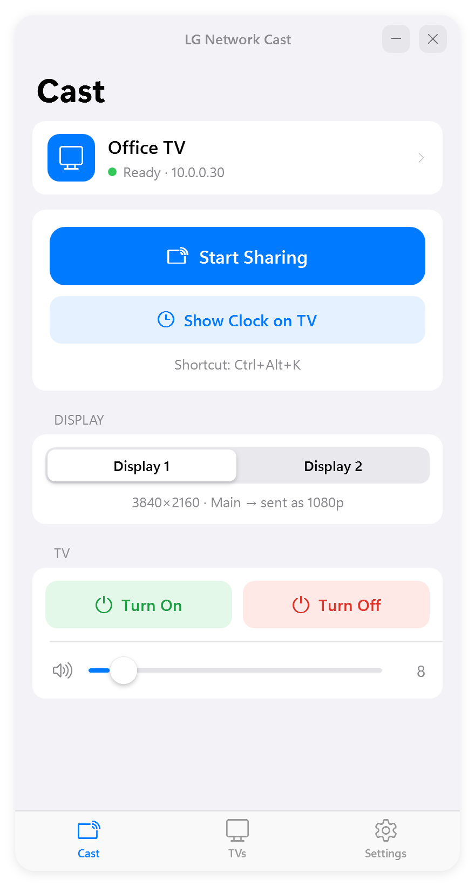
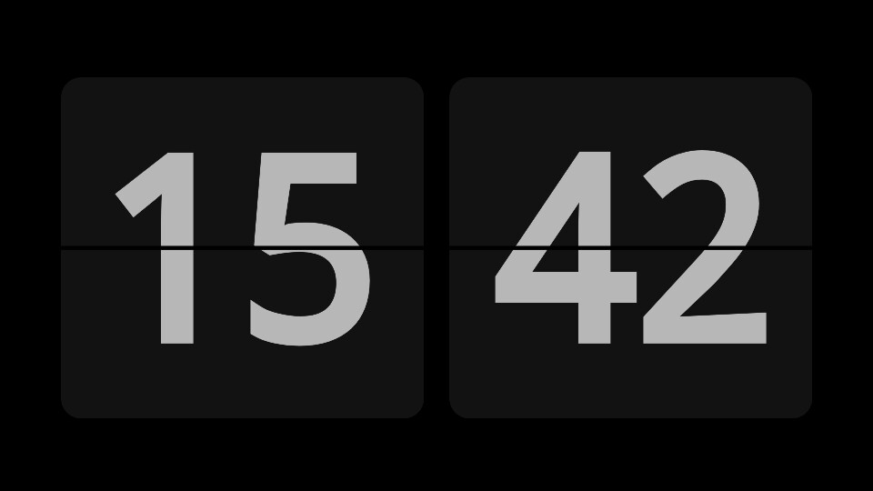

# LG Network Cast

**Share your Windows screen to an LG webOS TV over the network cable, with under a second of delay.** No Wi-Fi adapter, Miracast, HDMI cable, or app on the TV needed.

LG Network Cast is a small Windows tray app. It captures a monitor, encodes it to H.264 on your graphics card, and streams it over your local network to the TV's built-in web engine, which plays it full screen. It also controls the TV: power on/off, volume, and a paper-style **flip clock** you can put on the TV whenever you like.

<p align="center">
  
  &nbsp;&nbsp;
  
</p>

## Features

- **Screen sharing with under 1 s of delay**: 1080p (or native 4K) H.264, hardware-encoded with NVIDIA NVENC, Intel Quick Sync or AMD AMF, with x264 as a fallback.
- **Works over Ethernet.** Windows' own *Cast* (Win+K) needs Wi-Fi Direct; this doesn't.
- **Pick which monitor** to share on multi-monitor PCs.
- **TV control**: turn the TV on (Wake-on-LAN) and off, change the volume, mute.
- **Flip clock on the TV**: 24-hour paper-flip clock that runs *on the TV itself* (it keeps going even if the PC sleeps).
- **Finds TVs automatically** (SSDP). You can manage several TVs, choose a default, and rename them.
- **Global keyboard shortcuts** that work from anywhere, and you can change them all.
- **Tray only**: no taskbar button, and it can start with Windows.
- **Self-healing**: reconnects after network blips and sleep, finds the TV again if its IP changes, re-pairs after a TV reset, retries the TV page, and falls back to DLNA if needed.
- **Returns the TV to what it was showing** (e.g. HDMI 1) when you stop.
- iOS-style interface, about 1 MB app with no runtime to install (uses .NET Framework 4.8, built into Windows 10/11).

## Requirements

- Windows 10 or 11 (64-bit)
- An LG TV with webOS (tested on webOS 5 / 2020 NanoCell). The PC and TV must be on the same network.
- For turning the TV on from the PC, enable this on the TV once: **Settings → All Settings → General → Devices → TV On With Mobile → Turn on via Wi-Fi** (on some models: *Mobile TV On*). The TV doesn't let apps change this setting, but the app detects when it's off and tells you.

## Install

1. Download `LGNetworkCast-Setup-x.y.z.exe` from [Releases](https://github.com/HayTaub/LG-TV-Network-cast/releases) and run it. No admin rights are needed.
2. The app opens on the **TVs** tab and searches the network. Click **Add** next to your TV.
3. **Accept the prompt on the TV** with the remote. This pairs the app with the TV once.
4. The first time you share, Windows asks whether LG Network Cast may use the network. Click **Allow**, otherwise the TV can't reach the PC.

## Updates

The app checks GitHub Releases for new versions and installs them **over the existing install**. You never need to uninstall, and your TVs, shortcuts and settings are kept. With **Settings → Install updates automatically** turned on, it waits until nothing is showing on the TV, then updates and restarts in the tray. Otherwise, click **Update** in Settings.

To publish an update: bump `<Version>` in `src/LGNetworkCast/LGNetworkCast.csproj`, run `scripts\build.ps1`, and create a GitHub release tagged `vX.Y.Z` with `dist\LGNetworkCast-Setup-X.Y.Z.exe` attached. The repository the app checks is `Updater.DefaultRepo` (it can be overridden with `UpdateRepo` in `settings.json`).

## Default shortcuts

| Action | Shortcut |
|---|---|
| Start / stop sharing | `Ctrl+Alt+K` |
| Show / hide the flip clock | `Ctrl+Alt+C` |
| Turn TV on | `Ctrl+Alt+O` |
| Turn TV off | `Ctrl+Alt+X` |
| Volume up / down | `Ctrl+Alt+↑` / `Ctrl+Alt+↓` |
| Mute / unmute | `Ctrl+Alt+M` |

Change them under **Settings → Keyboard shortcuts**: click a shortcut and press the new keys (you can even take over `Ctrl+K`). Backspace clears a shortcut. Note that `Win+K` belongs to Windows and can't be used.

## How it works

```
 PC                                                         LG TV
┌───────────────────────────────────────────┐              ┌───────────────────────────┐
│ ffmpeg: ddagrab (Desktop Duplication)     │              │ Web engine, full screen   │
│   → scale to 1080p → H.264 (GPU encoder)  │   WebSocket  │   Media Source Extensions │
│   → fragmented MP4                        │ ───────────▶ │   → hardware H.264 decode │
│ LG Network Cast: HTTP + WebSocket server  │   (LAN)      │                           │
│                                           │              │                           │
│ webOS SSAP client (ws://tv:3000)          │ ───────────▶ │ power, volume, open page  │
└───────────────────────────────────────────┘              └───────────────────────────┘
```

- **Fast mode** (default): the TV opens a black, full-screen page served by the app. The page receives the H.264 stream over a WebSocket and plays it through Media Source Extensions. It speeds up playback slightly to catch up whenever it falls behind. Measured end-to-end delay: **about 0.8 s** at 1080p.
- **DLNA mode**: the stream is sent as MPEG-TS to the TV's own media player (UPnP AVTransport). No web page is involved, but LG's player always buffers about 12 seconds, so use this only for slides or dashboards.
- **TV control** uses LG's documented-in-the-wild *SSAP* protocol, the same one LG's phone app uses.
- **Flip clock**: a canvas page (a port of a WinForms flip-clock screensaver) that the TV renders on its own. It takes its time from the PC.

Each piece is in one place:

| File | What it does |
|---|---|
| `src/LGNetworkCast/Core/WebOsTv.cs` | SSAP client: pairing, power, volume, apps |
| `src/LGNetworkCast/Core/Discovery.cs` | SSDP discovery of webOS TVs |
| `src/LGNetworkCast/Core/StreamServer.cs` | HTTP + WebSocket server on a raw socket (no admin URL ACLs) |
| `src/LGNetworkCast/Core/Encoder.cs` | ffmpeg command lines, encoder detection |
| `src/LGNetworkCast/Core/Monitors.cs` | DXGI monitor list (matches ffmpeg's `ddagrab` numbering) |
| `src/LGNetworkCast/Core/CastController.cs` | Sharing / clock / power logic and self-healing |
| `src/LGNetworkCast/Resources/viewer.html` | Low-latency player page for the TV |
| `src/LGNetworkCast/Resources/clock.html` | Flip clock page for the TV |

## Build from source

Requirements: [.NET SDK 8+](https://dotnet.microsoft.com/download) and, for the installer, [Inno Setup 6](https://jrsoftware.org/isinfo.php) (`winget install JRSoftware.InnoSetup`).

```powershell
powershell -ExecutionPolicy Bypass -File scripts\build.ps1
```

The script downloads `ffmpeg.exe` into `tools\` (which git ignores), builds `src\LGNetworkCast\bin\Release\net48\`, and writes the installer to `dist\`.

## Troubleshooting

| Problem | Fix |
|---|---|
| TV not found | Make sure the TV is on and on the same network/subnet. Try **TVs → Add by IP address**. |
| Page opens on the TV but stays on "Connecting to PC…" | Windows Firewall is blocking the app. Allow *LG Network Cast* under *Windows Security → Firewall → Allow an app*. |
| TV doesn't turn on from the PC | Enable *Turn on via Wi-Fi* on the TV (see Requirements). The app shows an orange hint when it's off. A TV that has been unplugged from power can only be woken with the remote. |
| Tray icon not visible | Windows 11 hides new tray icons behind **^**. The app un-hides its icon automatically (takes effect after the next sign-in), or drag it onto the taskbar yourself. |
| No sound on the TV | Sound stays on the PC (video only, by design for low delay). |
| Anything else | **Settings → Open log folder** and check `log.txt`. |

Settings are stored in `%AppData%\LGNetworkCast\settings.json`.

## Roadmap

- Sound to the TV (WASAPI loopback → AAC)
- Share a single window or a region
- Dark mode for the app window

## License

[MIT](LICENSE). The bundled FFmpeg is GPL-licensed and runs as a separate program. See [THIRD-PARTY-NOTICES.md](THIRD-PARTY-NOTICES.md).

*LG and webOS are trademarks of LG Electronics. This project is not affiliated with or endorsed by LG.*
